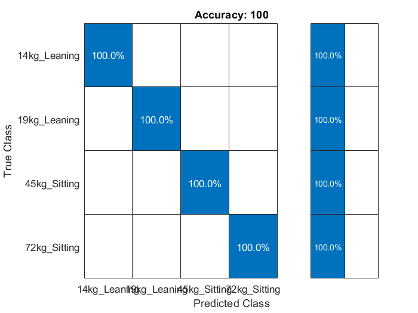
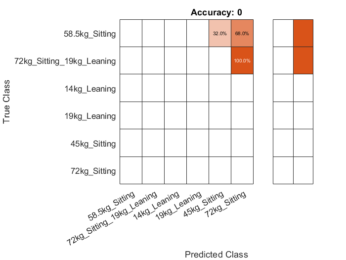

# Bamboo Chair Loadcase Classification and Fatigue Life

Coursework for **ME 780: Design of a Mechatronics System**, University of Waterloo, Winter 2021 (Design Assignment 3).

A MATLAB neural network that identifies which loadcase is acting on a bamboo chair (a child or adult sitting, or someone leaning back) from the applied load and the positions of three points on the frame. The cycles to failure for each loadcase were then estimated analytically from the material's fatigue data.

## Model

| Component | Details |
|---|---|
| Network | `patternnet`, a feed-forward pattern-recognition network |
| Inputs (7) | Maximum load applied, and x/y of the load application point, the backrest/armrest junction and the armrest |
| Hidden layer | 10 neurons, `tansig` |
| Output layer | 4 neurons, softmax (one per training loadcase) |
| Training | Up to 2000 epochs, regularization 0.01, default 70/15/15 random split |

## Data

| Set | Loadcases | Samples |
|---|---|---|
| `trainData.xlsx` | 45 kg sitting, 72 kg sitting, 14 kg leaning, 19 kg leaning | 50 each, 200 total |
| `testData.xlsx` | 58.5 kg sitting, 72 kg sitting + 19 kg leaning | 50 each, 100 total |

The data sets were provided with the course.

## Results

**Training data:** 100% accuracy. The four loadcases are well separated, mostly by load magnitude for sitting vs. sitting and by the frame positions for sitting vs. leaning.



**Test data:** the two test loadcases are not among the network's four output classes, so strict accuracy is 0% by design. The interesting result is which trained class each one maps to:

- **58.5 kg sitting**, exactly halfway between the 45 kg and 72 kg cases, was classified 32% of the time as 45 kg sitting and 68% as 72 kg sitting.
- **72 kg sitting + 19 kg leaning** was classified as 72 kg sitting every time. The sitting load dominates the inputs, so the leaning component goes unnoticed.



The second case is why the write-up proposes splitting the problem into two classifiers: one for the sitting load, weighted on load magnitude, and one for the leaning load, weighted on the backrest/armrest junction position.

### Predicted fatigue life

Cycles to failure from the S-N data and the stress in the critical area:

| Loadcase | Cycles to failure |
|---|---|
| 45 kg child sitting | 9,235 |
| 72 kg adult sitting | 211 |
| 14 kg leaning back | 3,696,930 |
| 19 kg leaning back | 282,006 |

## Running it

Requires MATLAB (written in R2020b) with the Deep Learning Toolbox. From the repository root, run either:

- `lifecycle_nn.m`, a plain script (seeded with `rng(0)` so runs repeat), or
- `LifeCycleNN.mlx`, the original live script, with its saved outputs.

The weights and the data split are random, so an unseeded run can give slightly different numbers (for example, the 32/68 split) than the figures above.

## Repository layout

```
LifeCycleNN.mlx         Original live script (2021)
lifecycle_nn.m          Plain-script version
trainData.xlsx          Training data
testData.xlsx           Test data
figures/                Confusion matrices from the original run
docs/                   DA3 response paper
```

## History

The tag `v2021-original` is the work as submitted in April–May 2021. Later commits add this README, the `.m` script and the figures, and correct the live script's leftover title and description text from the MATLAB example it was started from. The code itself is unchanged.

No license is granted; all rights reserved.
